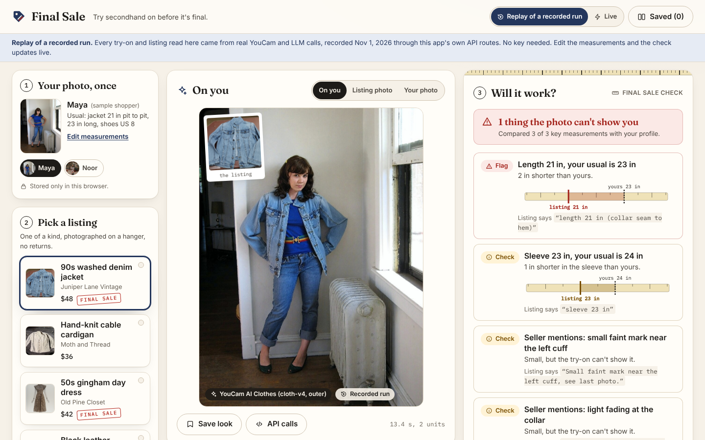

# Final Sale

**Try secondhand on before it's final.** Final Sale puts a resale listing on your own photo with the YouCam API,
then checks the listing's measurements and flaws against clothes that already fit you, because secondhand is
usually final sale.



- **Demo video:** [`demo/video.mp4`](demo/video.mp4) (narrated walkthrough, about 2 minutes)
- **Try it without a key:** run it locally (below) and stay in **Replay of a recorded run**, which is the default.
- Built for the YouCam API Skin AI & eCommerce VTO Hackathon, topic **eCommerce VTO**.

## The problem

Vintage and secondhand listings are one of a kind, rarely returnable, have no size chart, and are photographed on a
hanger or a bedroom floor. That is exactly where trying before buying matters most, and where nobody offers it.
Shoppers guess, sellers field the same "what are the measurements?" questions, and mistakes end as disputes or
unworn clothes.

## What it does

1. **Your photo, once.** A full-body photo and a few measurements from clothes you own that fit, laid flat. Both
   stay in your browser (IndexedDB and localStorage).
2. **Pick or paste a listing.** The listing's garment photo plus its text. **YouCam AI Clothes** (`cloth-v4`) puts
   the garment on you: jackets, coats and vests go to the `outer` category, sweaters and tops to `upper_body`, dresses
   to `full_body`. Boots and shoes go to **YouCam AI Shoes** (`shoes-transfer`).
3. **Will it work?** Next to the image, the final sale check. An LLM reads the listing into structured facts
   (measurements, fabric, flaws, size label, era, return policy), each with the seller's exact words. Plain code then
   verifies every quote against the listing, converts units and circumferences, and compares with your measurements:
   "Length 21 in, your usual is 23 in", "Seller mentions: small faint mark near the left cuff", "Not listed: length",
   with a ruler graphic and a drafted question to ask the seller.
4. **Style it with what you own.** Pick a piece from your closet and Final Sale chains two YouCam try-ons in dressing
   order (the dress first, then the jacket). Save looks and compare two listings side by side.

**The aha:** a crumpled thrift-listing photo becomes you wearing it, with a warning that the listing is two inches
shorter than what you usually wear.

**Honesty:** a try-on shows the look, not the fit. Measurements decide fit, which is why the check sits next to the
image, in the app and in this README.

## Who it's for

- Secondhand and vintage shoppers: budget-conscious, sustainability-minded, buying things they can't return.
- Resale platforms and small resellers, who lose sales when buyers can't picture an item, and who answer the same
  measurement questions over and over. Fewer abandoned carts, fewer "not as described" disputes.

## How it uses the YouCam API

| Step | Endpoint | Used for |
| --- | --- | --- |
| Register a file (free) | `POST /s2s/v2.0/file` | Returns a `file_id` and a signed upload URL for the shopper photo and the garment photo |
| Upload | `PUT <signed URL>` | The image bytes, with the headers YouCam returns |
| Try on clothes | `POST /s2s/v2.0/task/cloth-v4` with `src_file_id`, `ref_file_id`, `garment_category` | `outer`, `upper_body`, `full_body` (and `lower_body` for worn photos) |
| Try on shoes | `POST /s2s/v2.0/task/shoes-transfer` with `src_file_id`, `ref_file_id` | Boots and shoes on the shopper's own photo |
| Poll (free) | `GET /s2s/v2.0/task/<feature>/<task_id>` | Every 2.5 s, then 5 s, until `success` or `error` |
| Download | `GET results.url` | The result image, cached on the server and saved in the browser |

For an outfit, the first result is downloaded and uploaded again as the source of the second task, in layer order
(dress or bottoms, then tops, outerwear, shoes). Every result in the UI names the API that made it, and **API calls**
shows the exact sequence, timing and units.

YouCam errors such as `error_pose` or `error_apply_region_mismatch` are translated into plain advice ("Use a
straight-on photo from head to toe").

## Replay of a recorded run

Judges don't need keys. The app opens in **Replay of a recorded run**: two sample shoppers, four fictional listings
and two closet pieces, with every try-on image and listing reading recorded once through this app's own
`/api/tryon` and `/api/read-listing` routes (`scripts/record-tryon.mjs`, `scripts/record-listing.mjs`) and saved in
`src/data/fixtures` and `public/demo/results`. The final sale check is computed live in the browser, so editing the
measurements changes the verdict immediately. **Live** mode turns on when the server has keys.

## Run it

Requirements: Node 20 or newer and pnpm.

```bash
pnpm install
pnpm dev
```

Open http://localhost:3000. That's enough for Replay mode.

For Live mode, copy `.env.example` to `.env.local` and fill in:

| Variable | What |
| --- | --- |
| `YOUCAM_API_KEY` | YouCam API key (server-side only) |
| `YOUCAM_UNIT_BUDGET` | Optional hard cap on units this server may spend (default 40) |
| `OPENAI_BASE_URL`, `OPENAI_API_KEY`, `OPENAI_MODEL` | Any OpenAI-compatible endpoint whose model reads images; we used Qwen3.8 27B on W&B Inference |
| `ASSEMBLYAI_API_KEY` | Only for `scripts/make-video.mjs` (narration) |

Other commands:

```bash
pnpm build && pnpm start          # production build
pnpm lint
node scripts/check-secrets.mjs    # key scan over all history; prints nothing when clean
node scripts/screenshots.mjs      # docs/screenshots at 1440x900 (needs Playwright)
node --env-file=.env.local scripts/make-video.mjs   # demo/video.mp4 and demo/thumb.jpg
```

## How it's built

- **Next.js 16 (App Router) + TypeScript + Tailwind CSS 4**, pnpm.
- `src/app/api/tryon/route.ts`: YouCam pipeline (`src/lib/server/youcam.ts`), chaining, a disk cache keyed by a hash
  of the input images (the same photos never cost units twice), a per-server unit ledger with a hard budget, and one
  live job at a time so a double click can't fire two paid tasks.
- `src/app/api/read-listing/route.ts`: the listing reader. An OpenAI-compatible chat call with the listing text and
  photo, strict JSON-schema output, `maxRetries: 4`, a 60 s timeout, and zod validation.
- `src/lib/fit-check.ts`: the deterministic final sale check. Grounds each fact in the listing text, converts cm and
  all-round measurements to flat inches, applies per-measurement tolerances (with extra room for stretch fabrics),
  lists missing key measurements, flags flaws, notes vintage size labels and return policy, and drafts the seller
  question.
- `src/lib/routing.ts`: garment type to YouCam endpoint and category, and dressing order.
- Keys stay on the server; photos stay in the browser until you press **Try it on**.

## Accessibility

Built to WCAG 2.2 AA: semantic landmarks and headings, a skip link, visible focus rings, native `<dialog>` modals
(focus moves in and returns, Escape closes), labeled form fields with hints, text plus icon (never color alone) for
every flag, AA color contrast, 44 px touch targets, `aria-live` status for long try-ons, alt text on every image,
and `prefers-reduced-motion` support. Mobile-first: one column on phones, three columns on desktop.

## Limitations

- **Look, not fit.** The try-on image is a visualization. Fit decisions come from the measurements.
- YouCam's lower-body try-on needs a photo of the garment being worn, so flat-lay trousers and skirts don't work
  well. Bags (`/task/bag`) generate a styled scene rather than using your photo, so the app doesn't feature them.
- The listing reader only knows what the seller wrote. Missing measurements are called out, not guessed.
- Shoe-size conversions from EU and UK sizes are approximate and labeled as such.
- Replay mode covers the recorded combinations; anything else needs Live mode.

## Credits and licenses

- Code: [AGPL-3.0](LICENSE). Name and logo: see [TRADEMARKS.md](TRADEMARKS.md).
- Photos: Wikimedia Commons under the licenses listed in [docs/CREDITS.md](docs/CREDITS.md). Try-on results are
  derivatives of those photos, made with the YouCam API.
- All sellers, shops and listings are fictional. No real marketplace names, logos or brands are used.
- Fonts: Fraunces, Inter and IBM Plex Mono (SIL Open Font License), self-hosted via Fontsource.

More: [docs/api-log.md](docs/api-log.md) (dated log of API surprises and walls),
[docs/devpost-answers.md](docs/devpost-answers.md).
